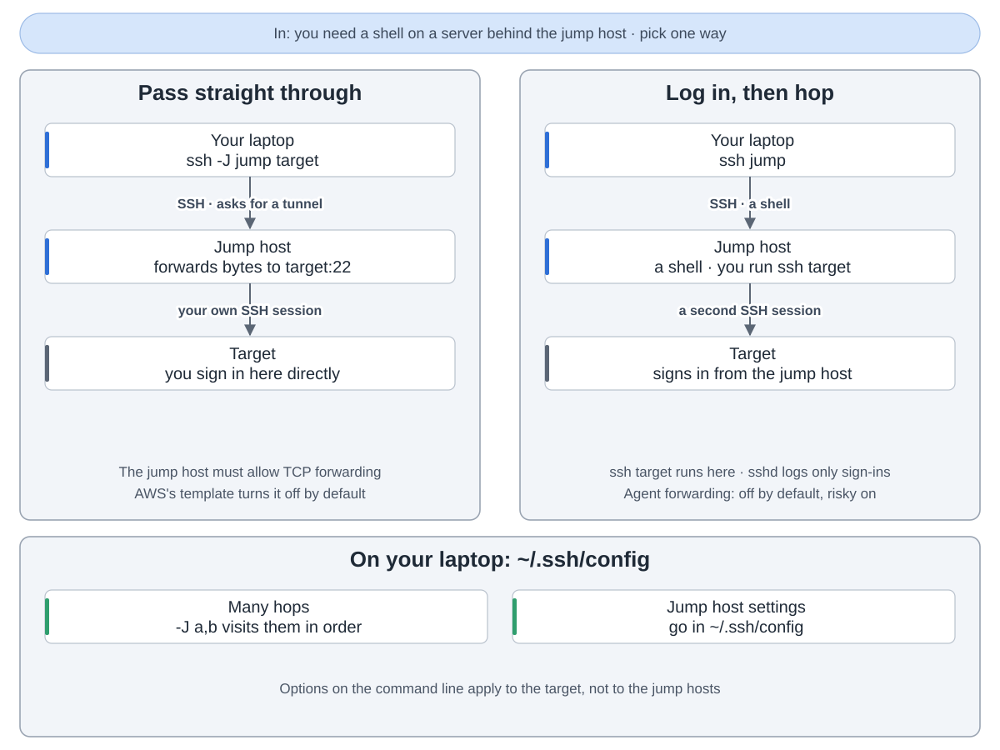
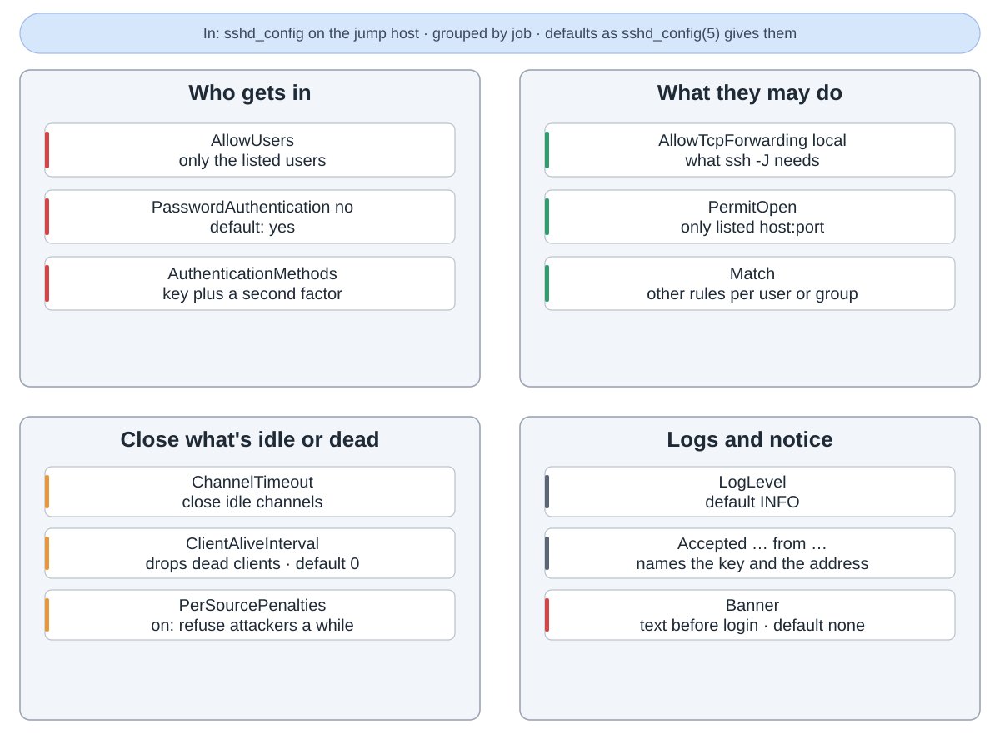
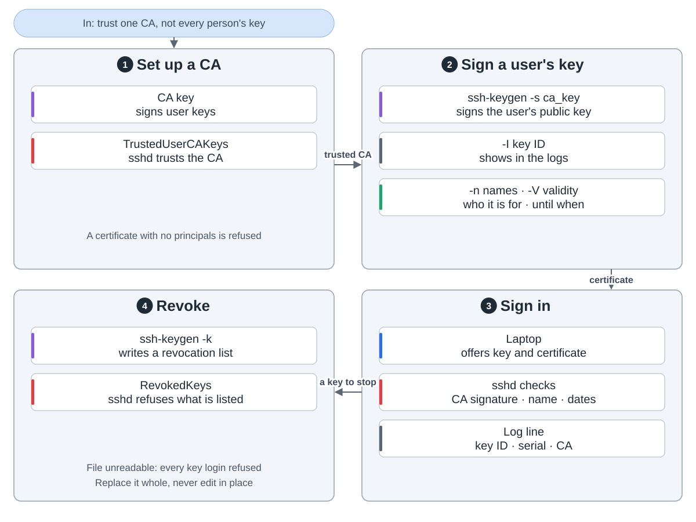
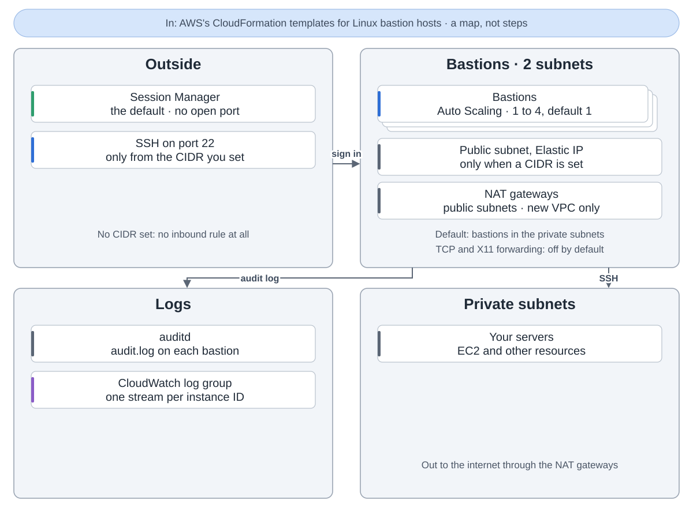

跳板机（bastion）是外面唯一连得上的服务器。先登录它，再从它进内网服务器。一道门，好锁也好看住。

**两种穿法。** 用 `ssh -J jump target`，跳板机只转发字节，你自己登录目标。或者先登录跳板机，再从它的 shell 里 ssh。这条 ssh 在跳板机上跑，但 sshd 只记登录，记命令得另加工具。直接穿过去要跳板机开 TCP 转发，AWS 参考模板默认是关的。

**把门锁好。** 跳板机的 sshd：只放列出的用户，不用密码，钥匙加第二因素，只许转发到列出的目标，闲着的通道关掉。每次登录成功都记下钥匙和地址。

**证书。** 不用把钥匙拷到每台服务器，由 CA 给每人的钥匙签上名字。到期日用 -V 设，默认没有。服务器只信 CA。丢了的钥匙进吊销列表。

**在 AWS 上。** aws-ia 的 Linux 跳板机模板在两个子网里运行 1 到 4 台跳板机，默认 1 台。新建 VPC 时两个子网分在两个可用区。默认在私有子网，不开端口，经 Session Manager 进来。设了地址段才进公有子网、配弹性 IP，可从那里 SSH。审计日志送到 CloudWatch。

来源：OpenSSH 提交 6a46ea6，aws-ia/cfn-ps-linux-bastion 提交 213dd9a。
