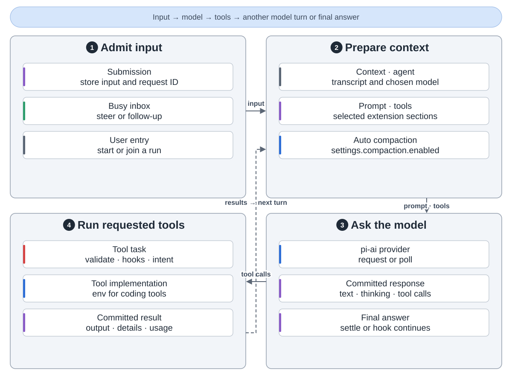
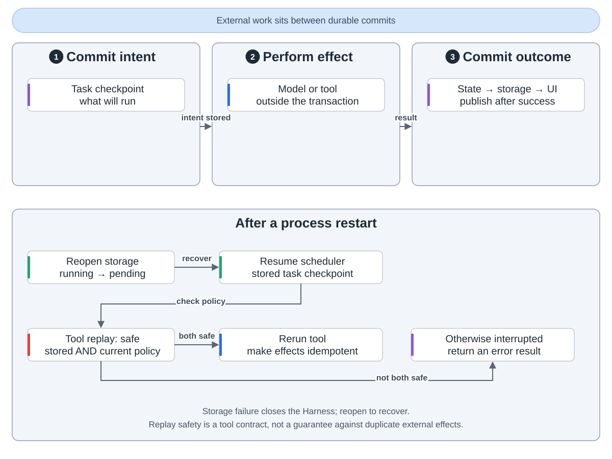
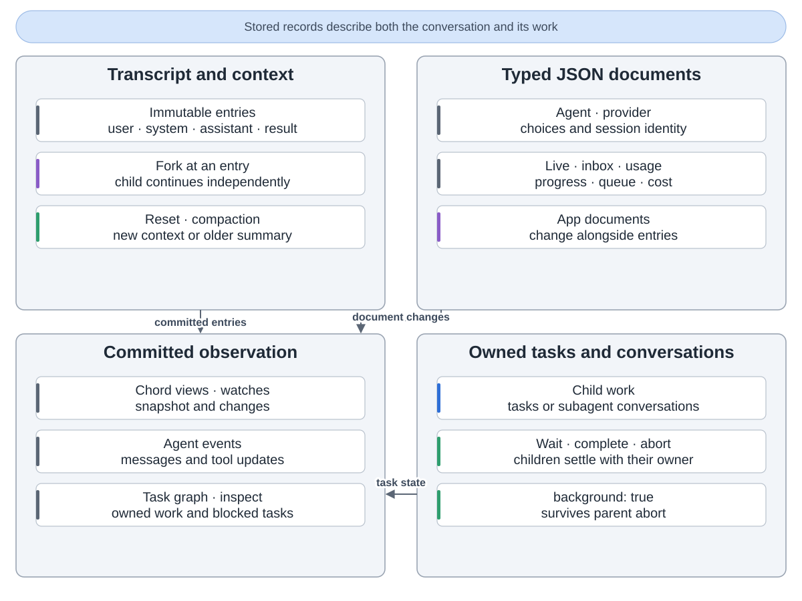
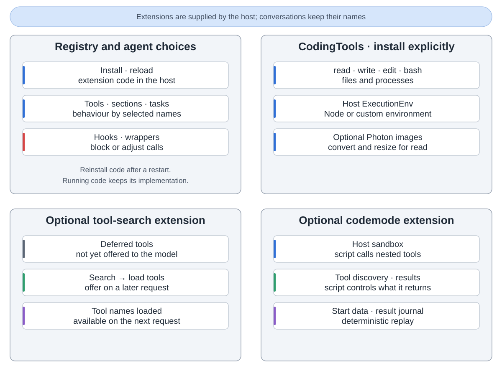
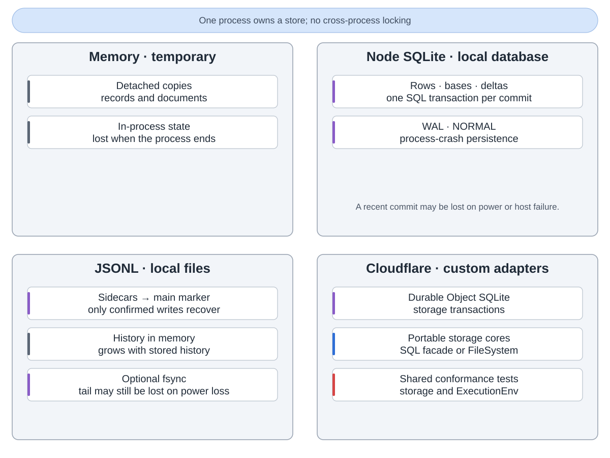

pi-durable 是 Pi 中的实验性智能体运行时。对话、任务检查点和 JSON 文档一起提交，提交成功后再更新界面。

输入启动模型或排队。生成任务准备上下文，经 pi-ai 调模型，再执行工具。结果进入下一轮；按设置自动压缩上下文。

外部执行前存意图，后存结果。重开恢复检查点，不派发任务；resume、新提交或等待才继续。工具已存和当前策略都允许安全重放才重跑，否则报中断。外部副作用仍需幂等。

分叉独立继续，重置保留历史。文档存配置、进度和应用状态；Chord 发布已提交变化。任务拥有子工作，后台标记形成取消边界。

宿主安装扩展、提供环境。编码工具需安装，图片处理、工具搜索与代码模式可选。代码模式需沙箱，用日志重放。重启需重装扩展代码。

内存临时；SQLite、JSONL、Durable Object SQLite 持久化，本地断电仍可能丢最近提交。存储由单进程拥有，错误关闭运行时，重开恢复。

