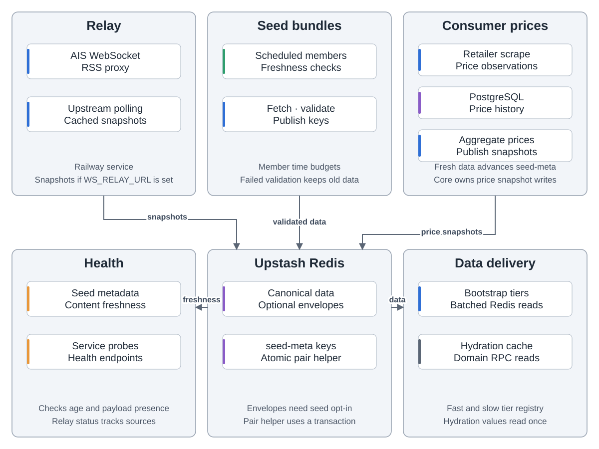
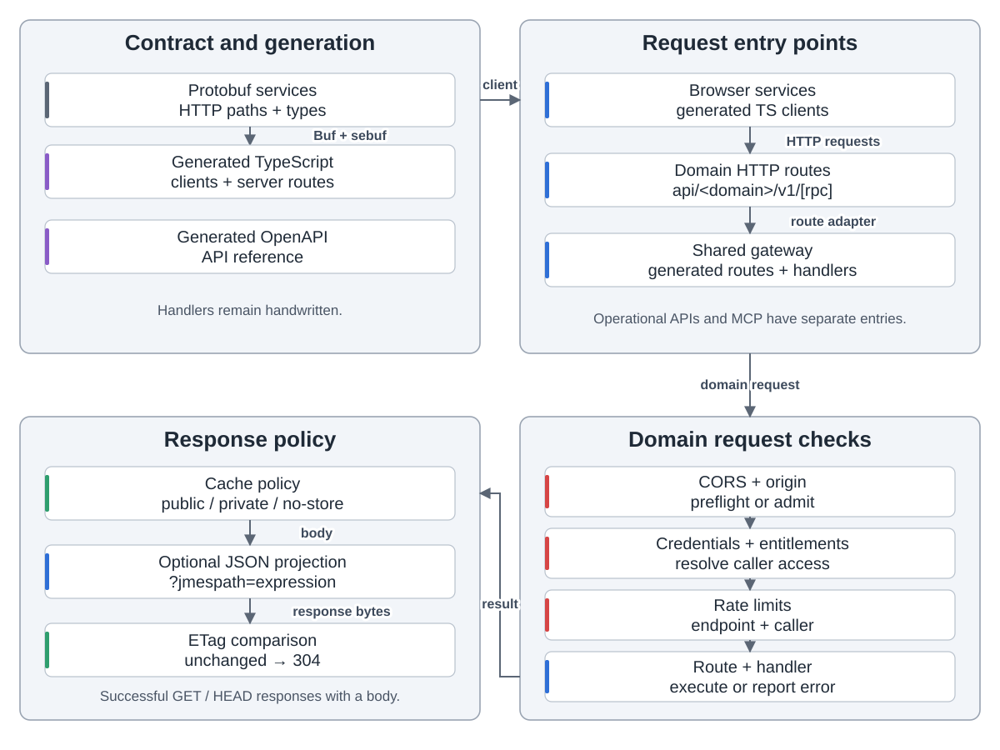
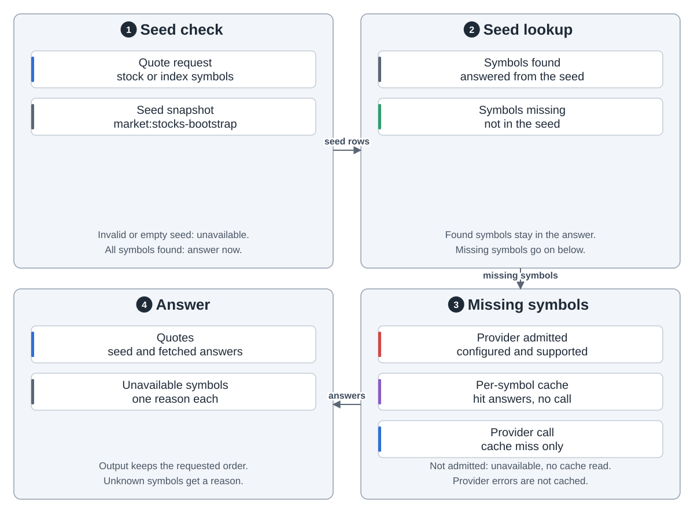
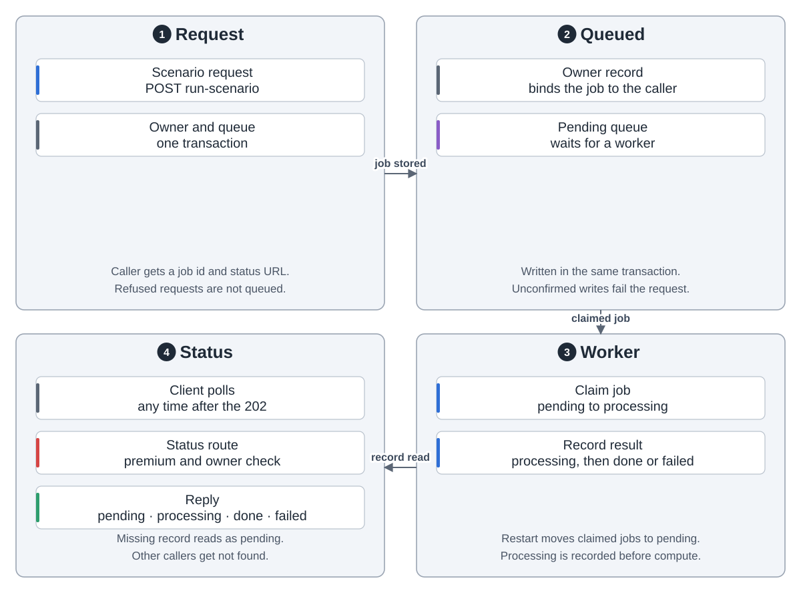
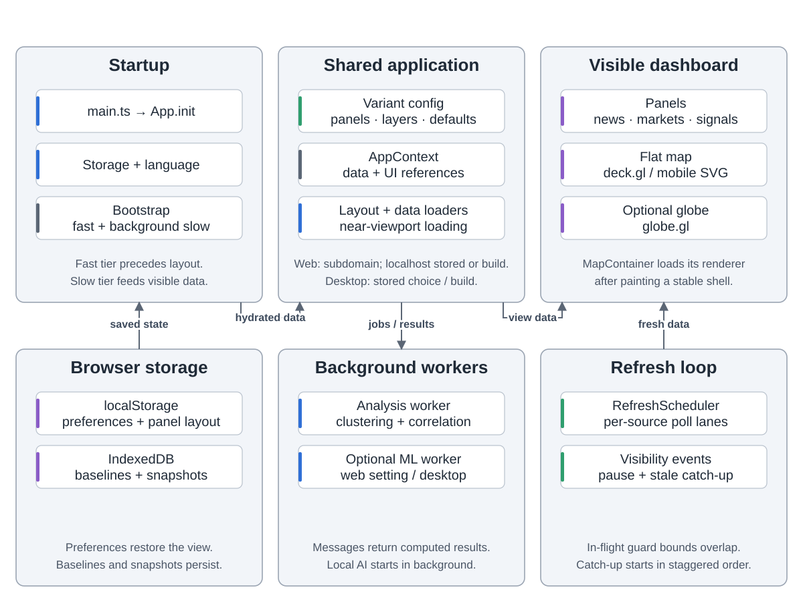
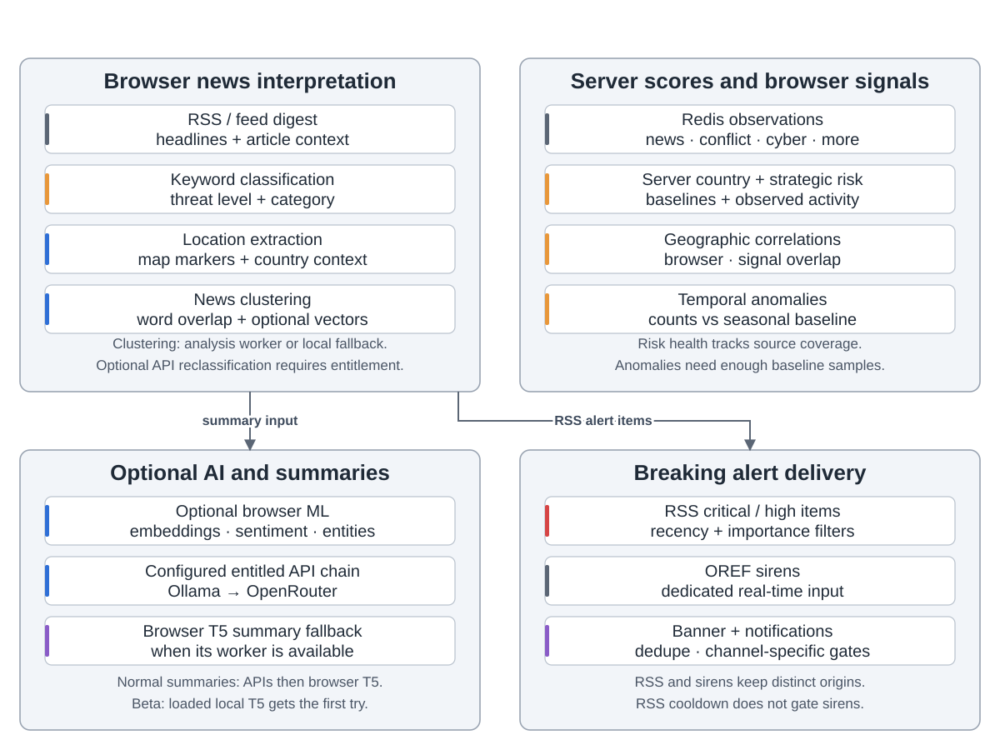
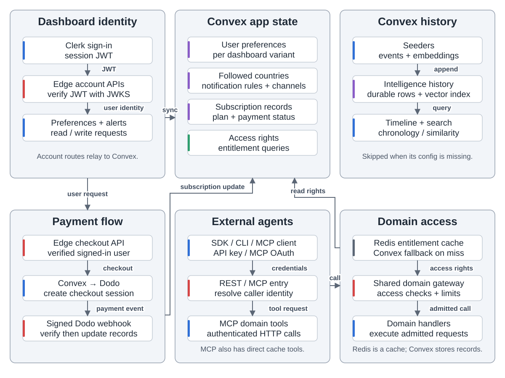
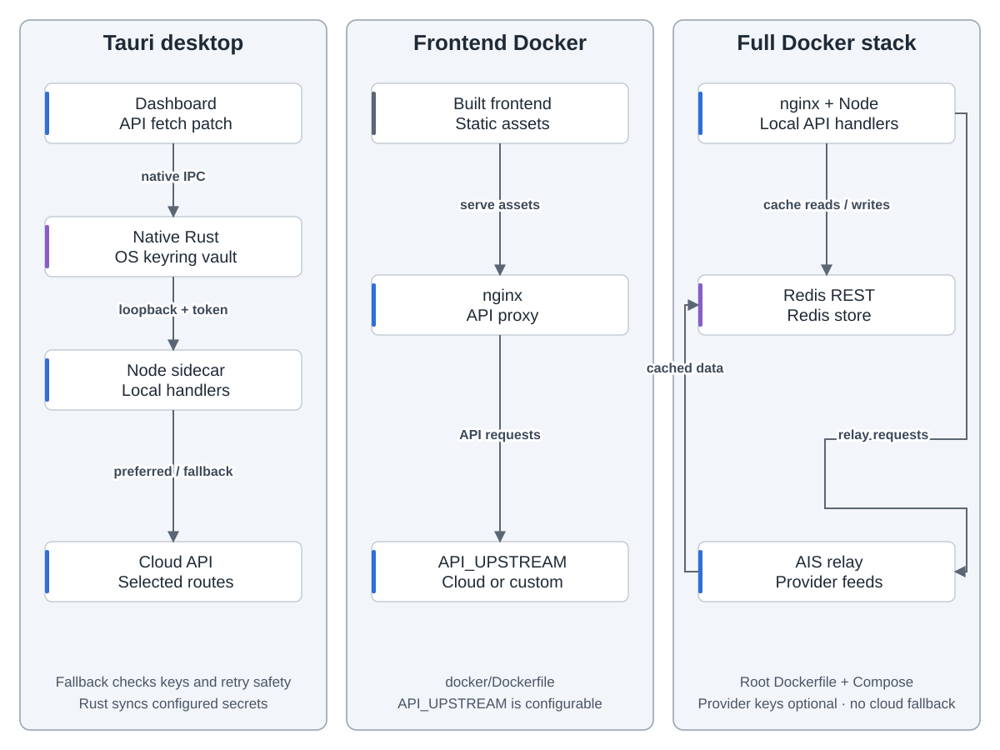
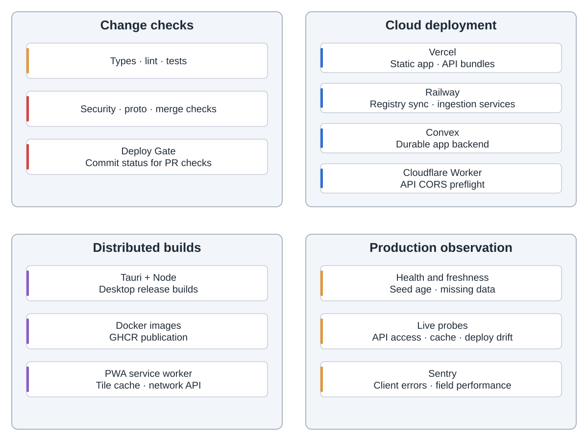

World Monitor 把新闻、市场、追踪、事件数据放进地图和面板。Railway 采集，Redis 共享数据，Convex 保存账户，配置齐全时存情报历史。

中继、定时采集、价格爬虫发布；启动接口读缓存，健康检查揭示过期与缺失。

契约生成接口，网关检查权限、限流、缓存。运维与 MCP 另设入口。

股票指数先读种子；缺代码先准入，再查缓存，未中才取价。

情景任务排队：先给任务号，后台计算，客户端轮询。

AppContext 连接加载器、面板、地图。存储保留偏好与历史；隐藏页暂停轮询，返回补刷。

浏览器整理新闻、发突发提醒；服务端评分读缓存；RSS、警笛分开告警。浏览器模型需开启或桌面模式；接口摘要需权益与配置，T5 兜底。

Clerk 识别用户，Dodo 支付更新 Convex 权益，支撑偏好、通知、密钥、智能体访问。

Tauri 启动 Node 服务，密钥存系统密钥库，部分接口优先云端，可回退。容器可代理云端或本地接口。

检查、部署、发行各走流程；探针、访问、部署审计跟踪生产，配 DSN 网页由 Sentry 上报。

