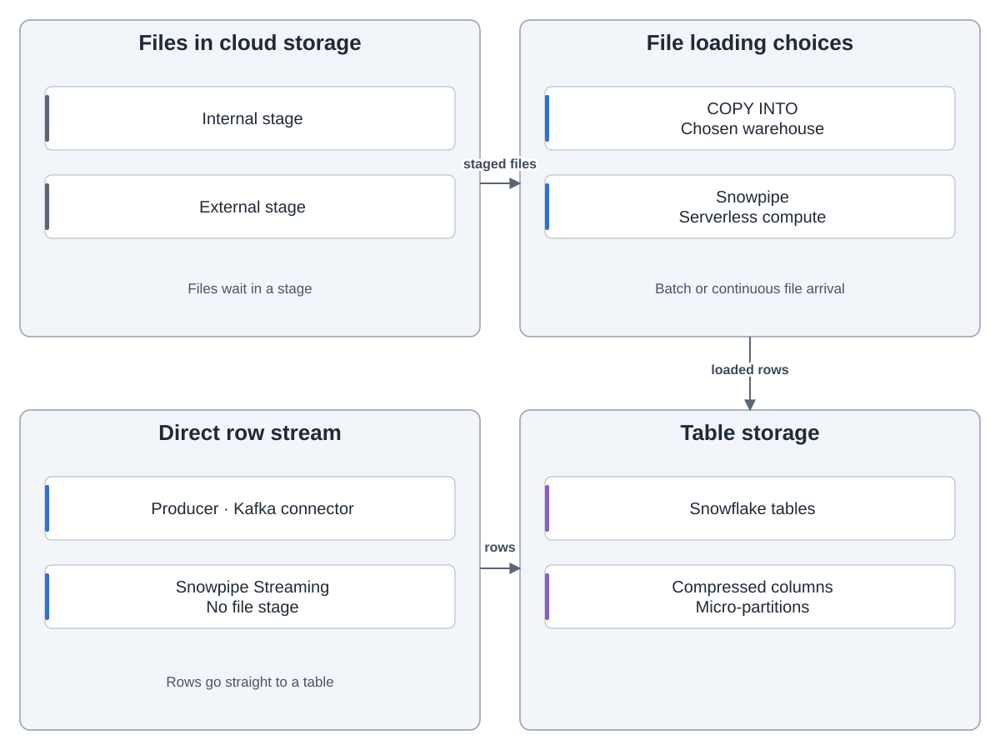
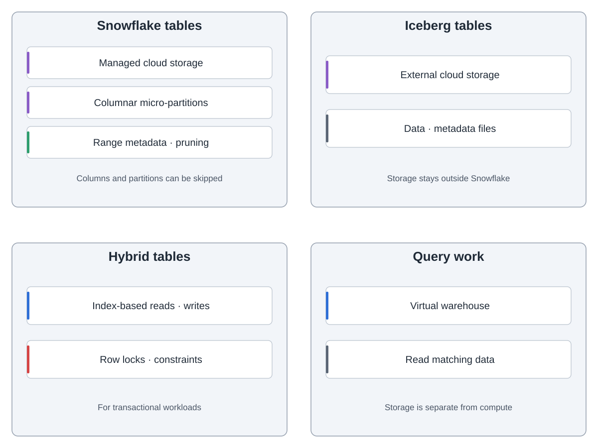
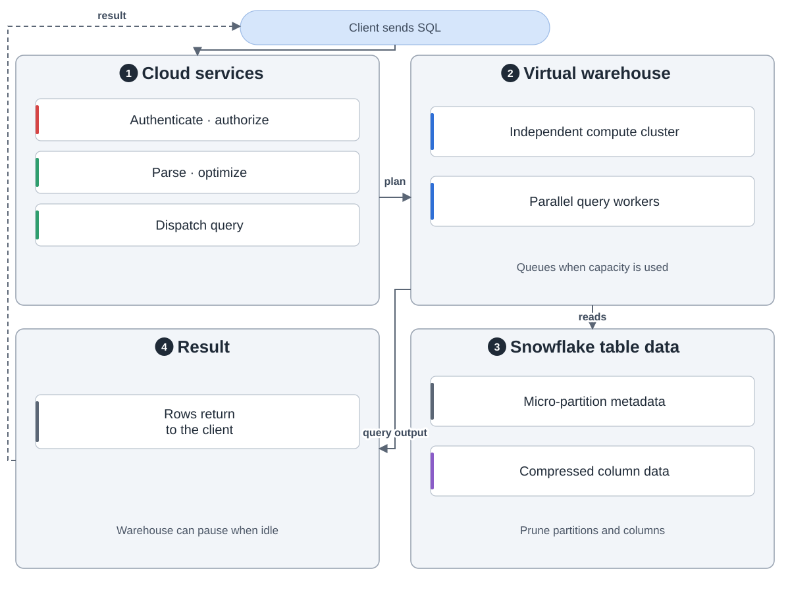
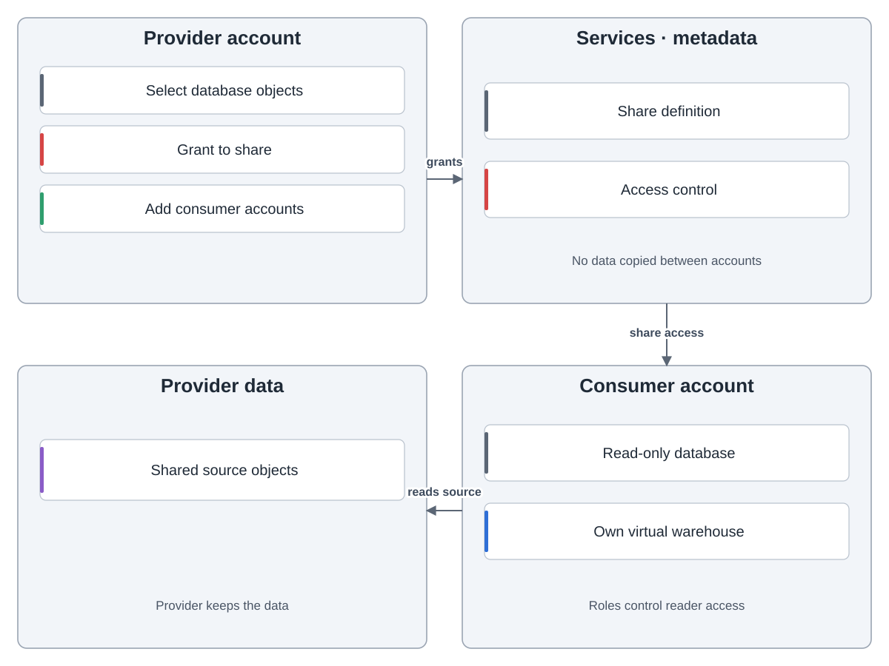

Snowflake separates cloud services, compute and storage. Clients send requests to cloud services, which handle identity, access, metadata and query planning. Independent virtual warehouses do the work against shared data.

Files can enter internal or external stages. `COPY INTO` loads them in batches using a chosen warehouse. Snowpipe loads arriving files with Snowflake-provided serverless compute. Snowpipe Streaming writes rows directly without a file stage.

Snowflake tables hold compressed columnar micro-partitions in cloud storage. Range metadata helps queries skip partitions and columns. Iceberg tables keep data and metadata files in external storage. Hybrid tables use indexes and row locks for transactional work.

For a query, cloud services check access, parse and optimize SQL, then dispatch it. A virtual warehouse runs the plan, reads matching data and returns results. Warehouses can be set to resume for work and suspend when idle.

A provider can grant selected objects to a share and add consumer accounts. A consumer creates a read-only database and queries it with its own warehouse. Snowflake uses services and metadata to expose the data without copying it between accounts.

